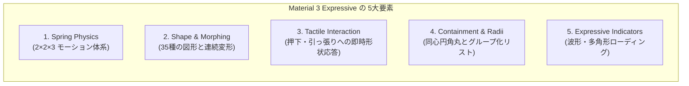

# Material 3 Expressive 設計体系 ＆ パッケージ移植リファレンス

本ドキュメントは、**Material 3 Expressive（M3 Expressive）** の設計思想・用法・トークン体系を体系化するとともに、本リポジトリの `packages/` および UI 実装からアプリ固有のドメイン知識を取り除き、**自作 Expressive パッケージへ機能とスタイルをそのまま移植・汎用化するための設計書**としてまとめたものです。

---

## 第1部：Material 3 Expressive の概要と設計原則

### 1.1 Material 3 Expressive とは？
**Material 3 Expressive** は、従来の Material Design 3（M3）の「クリーンで均質だが、時に平坦で無機質になりがち」という課題を克服するために導入された進化形デザインシステムです。
単なる見た目の装飾ではなく、**「物理法則に基づくスプリングモーション」「豊富な多角形シェイプとリアルタイム変形（モーフィング）」「触覚的（Tactile）なレスポンス」「大胆なコントラストと包含（Containment）構造」** を組み合わせ、ユーザーの操作に対して生き物のように反応する UI を構築します。

### 1.2 M3 Expressive を構成する 5つの柱（Core Pillars）



1. **時間（Duration）ではなく物理（Spring Physics）で動かす**
   - 従来の「300ms + `Curves.easeInOut`」のような固定時間アニメーションを排し、質量・剛性・減衰比（Damping Ratio）を持つスプリングシミュレーションで駆動します。
   - ドラッグ操作の指の速度（Velocity）がそのままアニメーションの初速に引き継がれ、途中で逆方向に切り替えても滑らかに軌道が変わります。
2. **静的な角丸から「意味を持って変形するシェイプ（Shape Morphing）」へ**
   - 要素の状態（静止・押下中・選択中・お気に入り・破壊的アクション）を「色」だけでなく **「形そのものの変化」** で伝えます（例：丸いボタンを指で押すと角丸四角形に引き締まる、お気に入りボタンを押すと円が宝石型 `gem` に弾ける）。
3. **「空間（Spatial）」と「効果（Effects）」の明確な分離**
   - 位置・サイズ・形・角度といった空間的な変化（**Spatial**）にはバウンス（オーバーシュート）を許容し、色・不透明度といった視覚効果（**Effects**）にはオーバーシュートしない臨界減衰スプリングを使います。
4. **主役（Hero）と脇役（Chrome）のメリハリ**
   - 画面内のすべてをバウンスさせるとうるさくなります。ナビゲーションバーやタブのスクロールなどの「枠組み（Chrome）」には落ち着いて収束する `standard` スプリングを使い、主役となるアクションや出現要素にのみ弾む `expressive` スプリングを使います。
5. **同心円角丸（Concentric Radii）とセグメント包含（Grouped Containment）**
   - カードの中にボタンを入れる際は `外側角丸 = 内側角丸 + パディング` の同心円ルールを守り、連続するリスト項目は「グループ全体の外周だけ大きく丸め（`28dp`）、項目間の境界は微小な角丸（`4dp`）と隙間（`2dp`）で区切る」ことで一体感を演出します。

---

## 第2部：M3 Expressive の用法・トークン体系（Motion & Shape）

パッケージの基盤（Core / Tokens 層）として定義すべきモーションとシェイプの用法ルールです。

### 2.1 スプリングモーション体系（12トークン：2スキーム × 2プロパティ × 3スピード）

M3 Expressive のモーションは、`motor` パッケージの `MaterialSpringMotion` が提供する以下のマトリクスで完全に表現できます。

| スキーム | プロパティ種別 | スピード | トークン名 (`MaterialSpringMotion.*`) | オーバーシュート | 主な用途・用法 |
| :--- | :--- | :--- | :--- | :---: | :--- |
| **Expressive**<br/>（弾力あり・感情的） | **Spatial**<br/>（位置・形・拡縮・回転） | **Fast** | `expressiveSpatialFast()` | **あり** | **小〜中要素の進入・押下・トグル**: ボタンの押下モーフ、ピル型スナックバーの出現・スタック移動、アイコンのポップ出現、シークバーの太さ変化 |
| | | **Default** | `expressiveSpatialDefault()` | **あり** | **大要素・画面構造の移動**: ボトムシートの進入、ドックプレイヤーの出現、テキストのアコーディオン展開、リスト行削除時の隙間閉鎖 |
| | | **Slow** | `expressiveSpatialSlow()` | **あり** | **大型の演出・背景要素**: 画面遷移を伴う大面積の変形、背景の大型シェイプの呼吸アニメーション |
| | **Effects**<br/>（色・透明度・影） | **Fast** | `expressiveEffectsFast()` | なし | ボタン押下時やトグル時の背景色・前景色・不透明度の素早い遷移 |
| | | **Default** | `expressiveEffectsDefault()` | なし | 中〜大要素の色や背景トーンの遷移 |
| | | **Slow** | `expressiveEffectsSlow()` | なし | 背景全体のカラーテーマ遷移など |
| **Standard**<br/>（落ち着き・機能的） | **Spatial**<br/>（位置・形・拡縮・回転） | **Fast** | `standardSpatialFast()` | なし（微小） | **要素の離脱・リリース復帰・ナビゲーション**: ボトムシートやスナックバーの退出、ドラッグキャンセル時の戻り、タブバーの選択移動・自動スクロール |
| | | **Default** | `standardSpatialDefault()` | なし（微小） | 標準的なレイアウトシフト |
| | | **Slow** | `standardSpatialSlow()` | なし（微小） | 背景で静かに動く装飾シェイプ（主張しすぎない背景演出） |
| | **Effects**<br/>（色・透明度・影） | **Fast / Default / Slow** | `standardEffectsFast()` 等 | なし | 退出時や標準コンポーネントのフェードアウト・色変化 |

#### モーション実装の3大ルール（パッケージ設計の鉄則）

> [!IMPORTANT]
> **ルール1：進入（Enter / Press-in）は `Expressive`、離脱（Exit / Release）は `Standard`**
> 要素が現れる時や指で押し込んだ時は `expressiveSpatial*` で弾ませ、要素が消える時や指を離して元に戻る時は `standardSpatialFast` に切り替えます。退出時までバウンスさせると、消え際にもたついて操作感が悪化するためです。
> ```dart
> motion: isVisibleOrPressed
>     ? const MaterialSpringMotion.expressiveSpatialFast()
>     : const MaterialSpringMotion.standardSpatialFast(),
> ```

> [!IMPORTANT]
> **ルール2：Spatial スプリングの出力値 `t` は用途に応じて「生の値」と「クランプ値」を使い分ける**
> `expressiveSpatial*` は目標値 `1.0` に対して `1.12` 程度までオーバーシュートし、`0.0` に戻る際も `-0.08` 程度までアンダーシュートします。
> - **生の値 `t` を使うもの**: `Transform.translate`、`Transform.scale`、`Transform.rotate`（物理的な跳ね返り・揺れをそのまま表現できる）
> - **`t.clamp(0.0, 1.0)` を使うもの**: `Opacity`、`Color.lerp`、`ShapeBorder.lerp`（`Morph`）、`BorderRadius.circular`（範囲外の値で描画破綻や Assertion エラーが起きるのを防ぐ。あるいは色・透明度用に `Effects` スプリングをネストする）

> [!IMPORTANT]
> **ルール3：アクセシビリティ（Reduce Motion）への配慮**
> `MediaQuery.maybeDisableAnimationsOf(context) ?? false` を取得し、`SingleMotionBuilder` の `active: !reduceMotion` に渡すことで、OS の「視差効果を減らす」設定時にアニメーションを即座にスキップして最終状態を描画できます。

---

### 2.2 シェイプ体系とセマンティックな使い分け

M3 Expressive では、以下の **2系統のシェイプ表現** を併用します。

1. **連続曲率の角丸矩形（`RoundedSuperellipseBorder` / `RoundedRectangleBorder` / `StadiumBorder`）**
   - ボタン、カード、シート、チップなどの**テキストを含むコンテナ**に使用します。
   - **M3 Expressive の角丸変化の原則（Round ↔ Square Morph）**:
     - **ボタン押下時（Press）**: 「丸い状態（Pill / Circle）」から「より四角い状態（角丸半径 `12dp〜20dp`）」へ引き締まります。
     - **チップ選択時（Select）**: 「四角い状態（`12dp`）」から「丸いピル状態（`22dp` / Stadium）」へ膨らみます。
     - **トグルボタン（Subscribe 等）**: 未選択の目立つ主役状態は「完全なピル（`30dp`）」、選択済みの落ち着いた状態は「角丸四角形（`18dp`）」へ変化します。
2. **ポリゴンシェイプ（`MaterialShapes` 全35種 ＋ `MaterialShapeBorder`）**
   - アバター、カバーアート、ヒーローアイコンバッジ、フローティングアクション、背景装飾、ローディングなどの**正方形（1:1）領域のシルエット**に使用します。

#### `MaterialShapes` のセマンティック（意味的）割り当てガイドライン
デザインに統一感を持たせるため、各シェイプの「キャラクター」に応じて役割を固定するのが Expressive スタイルの定石です。

| カテゴリ | 代表的なシェイプ (`MaterialShapes.*`) | 推奨される UI ロール・意味付け |
| :--- | :--- | :--- |
| **穏やかな有機シェイプ** | `clover4Leaf`, `clover8Leaf`, `flower`, `puffy`, `bun` | **静止時のメディアカバー・サムネイル**: 四角形よりも親しみやすく、かつ主張しすぎない |
| **多角形クッキー系** | `cookie4Sided`, `cookie6Sided`, `cookie7Sided`, `cookie9Sided`, `cookie12Sided` | **フォーカス・選択状態・完了バッジ・セカンダリアクション**: `clover4Leaf`（通常）→ `cookie7Sided`（選択/アクティブ）へのモーフィング相性が抜群 |
| **輝き・スパイク系** | `sunny`, `verySunny`, `softBurst`, `burst`, `boom`, `softBoom` | **警告・破壊的アクション（Delete等）・注目バッジ**: ダイアログの削除確認アイコンや、削除ボタン押下時の背景出現（`circle` → `sunny`）に最適 |
| **幾何学・宝石系** | `gem`, `pentagon`, `diamond`, `slanted`, `triangle` | **特別な状態変化（お気に入り・プレミアム等）**: 例：お気に入りボタンの `circle`（未登録）→ `gem`（登録済み） |
| **方向性・カプセル系** | `arch`, `semiCircle`, `pill`, `oval`, `arrow`, `fan` | **パーツの組み合わせ・方向示唆**: 例：ピル型スナックバーの左端に `-90°` 回転させた `arch` をアイコンチップとして嵌め込む（同心的な形状調和） |

---

## 第3部：`packages/` 全6パッケージの技術仕様と内部アルゴリズム

移植元となる `packages/` 配下の6つのパッケージの責務と構造です。

### 3.1 `expressive_shapes`（シェイプ＆モーフィングエンジン）
AndroidX の `androidx.graphics.shapes` を Flutter へ完全移植したジオメトリエンジンです。

- **ファイル構成**:
  - `packages/expressive_shapes/lib/src/material_shapes.dart`: 全35種の正規化済み `RoundedPolygon` 定数と `MaterialShapes.all` リスト
  - `packages/expressive_shapes/lib/src/material_shape_border.dart`: Flutter の `OutlinedBorder` を継承した `MaterialShapeBorder`
  - `packages/expressive_shapes/lib/src/shapes/`: `RoundedPolygon`, `Morph`, `CornerRounding`, `Cubic`, `Feature`, `MeasuredPolygon`
- **内部アルゴリズムの核心**:
  1. **ベジェ曲線化**: すべての多角形を「角（`CornerFeature`：円弧近似 Cubic ＋ 両端の Smoothing フランキング Cubic の計3本）」と「辺（`EdgeFeature`：直線 Cubic 1本）」に分解し、連続した `List<Cubic>` として保持します。
  2. **特徴点マッチング (`Morph`)**: 2つの異なる `RoundedPolygon` をモーフィングする際、外周長で正規化した進行度（`0.0..1.0`）上で凸角同士・凹角同士を最短距離で対応付け（`featureMapper`）、曲線数が異なる部分を互いに分割（`cutAtProgress`）して **1対1の `List<(Cubic, Cubic)>` ペア** を構築します。これにより、描画時は単なる数値の線形補間（`lerp`）だけで超高速に中間 Path を生成できます。
  3. **`MaterialShapeBorder` の `squash` パラメータ**:
     - `squash: 0.0`（デフォルト）では、長方形の Widget に適用しても短辺に合わせた 1:1 の正方形アスペクト比で中央に描画されます。
     - `squash: 1.0` にすると Widget の縦横比に合わせて引き伸ばされます（`0.0〜1.0` で補間可能）。

#### 使用方法コード例
```dart
// 1. ShapeDecoration や ClipPath で使う
Container(
  width: 72,
  height: 72,
  decoration: ShapeDecoration(
    color: colorScheme.secondaryContainer,
    shape: MaterialShapeBorder(
      shape: MaterialShapes.cookie7Sided,
      squash: 0.0,
    ),
  ),
  child: const Icon(Icons.check_rounded),
)

// 2. 2つのシェイプ間を補間する（t は 0.0..1.0 にクランプすること）
final ShapeBorder border = MaterialShapeBorder(
  shape: MaterialShapes.clover4Leaf,
).lerpTo(
  MaterialShapeBorder(shape: MaterialShapes.cookie7Sided),
  t.clamp(0.0, 1.0),
)!;
```
> [!WARNING]
> `MaterialShapeBorder.lerpTo` が返す中間状態の `MaterialShapeBorder` は内部的に `shape = null`（`_cubics` のみ保持）になります。そのため、**lerp 結果の Border に対してさらに `lerpTo` を呼ぶと `StateError` がスローされます**。常に元の `shape` を持つ2つの `MaterialShapeBorder` の間で `lerpTo` してください。

---

### 3.2 `expressive_loading_indicator`（モーフィング・ローディング）
AndroidX Compose Material 3 の `LoadingIndicator` の移植実装です。

- **ファイル構成**:
  - `packages/expressive_loading_indicator/lib/src/loading_indicator.dart`
  - `packages/expressive_loading_indicator/lib/src/loading_indicator_theme.dart`
- **4つのバリアント**:
  - `LoadingIndicator()` — 背景なし・無限アニメーション
  - `LoadingIndicator.contained()` — 円形背景（`primaryContainer`）あり・無限アニメーション
  - `LoadingIndicator.determinate(progress: 0.0..1.0)` — 背景なし・外部進捗連動
  - `LoadingIndicator.containedDeterminate(progress: 0.0..1.0)` — 円形背景あり・外部進捗連動
- **アニメーションの振付（Choreography）**:
  - **Indeterminate**: 7つの図形（`softBurst` → `cookie9Sided` → `pentagon` → `pill` → `sunny` → `cookie4Sided` → `oval`）を1ステップ **650ms** で巡回。前半 300ms は定速回転のみ、後半 300ms〜650ms で「次の図形へのモーフ（`Curves.easeOut`）」「追加回転」「`1.0 → 1.125 → 1.0` のスケールパルス」が同時に走ることで、小気味よいリズムを生みます。
  - **Determinate**: `circle`（18°回転済み）から `softBurst` へ、`progress (0.0 → 1.0)` に応じて反時計回りに `-180°` 回転しながら変形します。
  - **クリッピング防止の自動スケーリング**: 回転中に星形の先端などが枠からはみ出ないよう、`calculateBounds()` と回転最大境界 `calculateMaxBounds()` の比率を計算し、アクティブインジケーター基準サイズ（`38 / 48`）に掛け合わせて描画します。

---

### 3.3 `expressive_refresh_indicator`（Expressive Pull-to-Refresh）
Flutter 標準の `RefreshIndicator` のジェスチャー・スクロール通知処理と、`LoadingIndicator` ＋ `motor` スプリングを融合させたコンポーネントです。

- **ファイル構成**:
  - `packages/expressive_refresh_indicator/lib/src/expressive_refresh_indicator.dart`
- **状態遷移と物理演出**:
  ```mermaid
  stateDiagram-v2
      [*] --> Drag: スクロール端でプル開始
      Drag --> Armed: プル距離 >= 80dp (fraction >= 1.0)
      Drag --> Canceled: 閾値未満で指を離す
      Armed --> Refresh: 指を離す (onRefresh 発火)
      Refresh --> Done: Future 完了
      Canceled --> [*]: 臨界減衰スプリングで 0.0 へ収納
      Done --> [*]: Determinateへ戻りつつ 0.0 へ収納
  ```
  - **プル中 (`Drag` / `Armed`)**: `LoadingIndicator.containedDeterminate` を表示し、引っ張るほど `circle` → `softBurst` に変形しながら降りてきます。閾値（`80dp`）を超えるとゴム抵抗（最大2倍）が掛かりつつさらに逆回転します。
  - **リフレッシュ開始 (`Refresh`)**: 臨界減衰スプリング（`mass: 1, stiffness: 1500`）でバウンスさせずにピタッと定位置（`80dp`）へ収束させると同時に、200ms の `AnimatedSwitcher` で無限回転する `LoadingIndicator.contained` へシームレスに切り替えます。

---

### 3.4 `material_wavy_progress_indicator`（波形プログレスバー 2種）
AndroidX Compose Material 3 の `WavyProgressIndicator` の移植実装です。

- **ファイル構成**:
  - `packages/material_wavy_progress_indicator/lib/src/wavy_linear_progress_indicator.dart`
  - `packages/material_wavy_progress_indicator/lib/src/wavy_linear_progress_indicator_theme.dart`
  - `packages/material_wavy_progress_indicator/lib/src/circular_wavy_progress_indicator.dart`
- **共通仕様（端での自動フラット化）**:
  - Determinate モードにおいて、進捗が `0%` 付近や `100%` 付近（Linear は `10%〜90%` 外、Circular は `10%〜95%` 外）にあるときは、波の振幅（`amplitudeFraction`）が 500ms かけて自動的に `0` に減衰し、直線／真円になります。
- **Linear の特徴**:
  - アクティブ部分（波線）と未進捗トラック（直線）の間に `trackGap`（デフォルト `4dp`）の隙間が空き、トラックの右端には完了前のみ丸いストップインジケーター（`stopIndicatorWidth: 4dp`）が表示されます。
- **Circular の特徴**:
  - `expressive_shapes` の `RoundedPolygon.circle` と `RoundedPolygon.star` を `Morph` させて波の深さを表現します。円周長と `wavelength`（デフォルト `15dp`）から頂点数（波の数、最小5）を整数で算出するため、波が途中で途切れず綺麗に一周繋がります。

---

### 3.5 `expressive_sheet`（スプリング駆動モーダルボトムシート）
ドラッグ操作とスプリング物理を直結させた `PopupRoute` 実装です。

- **ファイル構成**:
  - `packages/expressive_sheet/lib/src/show_expressive_sheet.dart`
- **設計のポイント**:
  - `AnimationController.unbounded` を採用し、`createSimulation` をオーバーライドして進入時は `expressiveSpatialDefault()`、退出時は `standardSpatialFast()` の `Simulation` を返します。
  - シート上の縦ドラッグ量と離した瞬間の速度（`_releaseVelocity`）をシート自身の高さ（`context.size?.height`）で正規化してコントローラとシミュレーションに直接渡すため、**「指で弾いた速度のままバネで閉じていく／開いて戻る」** 一体感のある操作性を実現しています。
  - 背景スクリムには `_ClampedAnimation`（`0.0..1.0`）を渡し、シート本体の `FractionalTranslation` には生の `controller` を渡すことで、オーバーシュート時の背景の明滅を防いでいます。

---

### 3.6 `expressive_snack`（カードスタック＆シェイク型ピルスナックバー）
`OverlayEntry` 上で複数の通知ピルを立体的にスタック管理するスナックバーです。

- **ファイル構成**:
  - `packages/expressive_snack/lib/src/show_expressive_snack.dart`
  - `packages/expressive_snack/lib/src/snack.dart`
  - `packages/expressive_snack/lib/src/snack_overlay.dart`
  - `packages/expressive_snack/lib/src/snack_stack.dart`
  - `packages/expressive_snack/lib/src/snack_view.dart`
- **設計のポイント**:
  - **最大3段のカードスタック**: 新しいスナックが追加されると最前面（`depth = 0`）に配置され、既存のものは `depth = 1, 2` へ後退します。`depth` 1段につき上へ `12px` オフセット、スケール `-5%`、前面シャドウオーバーレイ `+15%` が `expressiveSpatialFast` スプリングで適用されます。
  - **重複時の昇格＋物理インパルスシェイク**: 同じ `message` と `icon` のスナックが既に表示されている場合、新規追加せずにそのスナックを最前面へ昇格させ、横軸の `AnimationController` に `SpringSimulation(..., start: 0, end: 0, velocity: 600)` を与えて物理的にシェイクさせます。
  - **アーチ型アイコンチップ**: アイコン付きの場合、ピルの左端の曲線にフィットするよう `MaterialShapes.arch` を `-90°`（RTL時は `+90°`）回転させた `32x32dp` のシェイプコンテナにアイコンを収めます。

---

## 第4部：汎用コンポーネント＆スタイル移植カタログ（設計ブループリント）

ここからは、アプリ固有のビジネスロジックを完全に排除し、**自作 Expressive パッケージに汎用 Widget としてそのまま収録できる 8つのスタイル＆コンポーネント実装パターン**を抽出・汎用化して提示します。

### 4.1 押下モーフィングボタン (`ExpressiveMorphButton`)

M3 Expressive の最も基本的なインタラクションです。「静止時は丸く（ピルまたは円）、押している間だけ角丸四角形に引き締まる」動作をスプリングで駆動します。

```dart
import 'package:expressive_loading_indicator/expressive_loading_indicator.dart';
import 'package:flutter/material.dart';
import 'package:motor/motor.dart';

/// 汎用的な M3 Expressive 押下モーフィングボタン
class ExpressiveMorphButton extends StatefulWidget {
  const ExpressiveMorphButton({
    super.key,
    required this.onPressed,
    required this.child,
    this.height = 64.0,
    this.restRadius = 32.0,    // 静止時はピル (height / 2)
    this.pressedRadius = 16.0, // 押下時は角丸四角形に引き締まる
    this.pressScale = 1.0,     // 必要に応じて 0.97 等の微小スケールを併用可能
    this.backgroundColor,
    this.foregroundColor,
    this.busy = false,
  });

  final VoidCallback? onPressed;
  final Widget child;
  final double height;
  final double restRadius;
  final double pressedRadius;
  final double pressScale;
  final Color? backgroundColor;
  final Color? foregroundColor;
  final bool busy;

  @override
  State<ExpressiveMorphButton> createState() => _ExpressiveMorphButtonState();
}

class _ExpressiveMorphButtonState extends State<ExpressiveMorphButton> {
  bool _pressed = false;

  @override
  Widget build(BuildContext context) {
    final cs = Theme.of(context).colorScheme;
    final bg = widget.backgroundColor ?? cs.primary;
    final fg = widget.foregroundColor ?? cs.onPrimary;
    final reduceMotion = MediaQuery.maybeDisableAnimationsOf(context) ?? false;

    return SingleMotionBuilder(
      motion: const MaterialSpringMotion.expressiveSpatialFast(),
      value: _pressed ? 1.0 : 0.0,
      active: !reduceMotion,
      builder: (context, t, child) {
        final tc = t.clamp(0.0, 1.0);
        final radius =
            widget.restRadius + (widget.pressedRadius - widget.restRadius) * tc;

        return Transform.scale(
          scale: 1.0 - (1.0 - widget.pressScale) * tc,
          child: Material(
            color: bg,
            shape: RoundedSuperellipseBorder(
              borderRadius: BorderRadius.circular(radius),
            ),
            clipBehavior: Clip.antiAlias,
            child: InkWell(
              onTap: widget.busy ? null : widget.onPressed,
              onHighlightChanged: (v) {
                if (_pressed != v) setState(() => _pressed = v);
              },
              child: child,
            ),
          ),
        );
      },
      child: SizedBox(
        height: widget.height,
        child: Center(
          child: widget.busy
              ? SizedBox.square(
                  dimension: widget.height * 0.6,
                  child: FittedBox(
                    child: LoadingIndicator(activeIndicatorColor: fg),
                  ),
                )
              : IconTheme.merge(
                  data: IconThemeData(color: fg),
                  child: DefaultTextStyle.merge(
                    style: TextStyle(color: fg, fontWeight: FontWeight.w700),
                    child: widget.child,
                  ),
                ),
        ),
      ),
    );
  }
}
```

---

### 4.2 状態＆押下プレビュー付きシェイプトグルボタン (`ExpressiveShapeToggle`)

お気に入りボタンや削除ボタン、フォロー切り替えなどに使えるパターンです。
- **特徴1（押下中プレビュー）**: 指を押した瞬間（`onTapDown`）に「トグル後の形」へ先にモーフィングを開始し、指を離した時（`onTap`）に色が確定して追従します。
- **特徴2（Spatial と Effects の分離）**: 形とスケールは `expressiveSpatialFast` で弾ませ、色は `expressiveEffectsFast`（またはクランプ値）で滑らかに遷移させます。

```dart
import 'dart:math' as math;
import 'package:expressive_shapes/expressive_shapes.dart';
import 'package:flutter/material.dart';
import 'package:motor/motor.dart';

class ExpressiveShapeToggle extends StatefulWidget {
  const ExpressiveShapeToggle({
    super.key,
    required this.selected,
    required this.onChanged,
    required this.icon,
    this.selectedIcon,
    this.unselectedShape,
    this.selectedShape,
    this.unselectedColor,
    this.selectedColor,
    this.unselectedForegroundColor,
    this.selectedForegroundColor,
    this.rotationTurnsOnSelect = 0.0,
    this.previewOnPress = true,
    this.size = 48.0,
  });

  final bool selected;
  final ValueChanged<bool> onChanged;
  final IconData icon;
  final IconData? selectedIcon;
  final RoundedPolygon? unselectedShape;
  final RoundedPolygon? selectedShape;
  final Color? unselectedColor;
  final Color? selectedColor;
  final Color? unselectedForegroundColor;
  final Color? selectedForegroundColor;
  final double rotationTurnsOnSelect;
  final bool previewOnPress;
  final double size;

  @override
  State<ExpressiveShapeToggle> createState() => _ExpressiveShapeToggleState();
}

class _ExpressiveShapeToggleState extends State<ExpressiveShapeToggle> {
  bool _down = false;

  @override
  Widget build(BuildContext context) {
    final cs = Theme.of(context).colorScheme;
    final reduce = MediaQuery.maybeDisableAnimationsOf(context) ?? false;
    final effectiveShapeTarget =
        (widget.previewOnPress && _down && !reduce) ? !widget.selected : widget.selected;

    final offBorder = MaterialShapeBorder(
      shape: widget.unselectedShape ?? MaterialShapes.circle,
    );
    final onBorder = MaterialShapeBorder(
      shape: widget.selectedShape ?? MaterialShapes.gem,
    );

    return SingleMotionBuilder(
      motion: const MaterialSpringMotion.expressiveEffectsFast(),
      value: widget.selected ? 1.0 : 0.0,
      active: !reduce,
      builder: (context, colorT, child) {
        final tc = colorT.clamp(0.0, 1.0);
        final bg = Color.lerp(
          widget.unselectedColor ?? cs.surfaceContainerHighest,
          widget.selectedColor ?? cs.tertiary,
          tc,
        )!;
        final fg = Color.lerp(
          widget.unselectedForegroundColor ?? cs.onSurface,
          widget.selectedForegroundColor ?? cs.onTertiary,
          tc,
        )!;

        return SingleMotionBuilder(
          motion: const MaterialSpringMotion.expressiveSpatialFast(),
          value: effectiveShapeTarget ? 1.0 : 0.0,
          active: !reduce,
          builder: (context, shapeT, _) {
            final stc = shapeT.clamp(0.0, 1.0);
            final border = ShapeBorder.lerp(offBorder, onBorder, stc) ?? offBorder;

            return SizedBox.square(
              dimension: widget.size,
              child: ClipPath(
                clipper: ShapeBorderClipper(shape: border),
                child: Material(
                  color: bg,
                  child: InkWell(
                    onTap: () => widget.onChanged(!widget.selected),
                    onTapDown: (_) => setState(() => _down = true),
                    onTapUp: (_) => setState(() => _down = false),
                    onTapCancel: () => setState(() => _down = false),
                    child: Center(
                      child: Transform.rotate(
                        angle: shapeT * widget.rotationTurnsOnSelect * 2 * math.pi,
                        child: Icon(
                          widget.selected
                              ? (widget.selectedIcon ?? widget.icon)
                              : widget.icon,
                          color: fg,
                        ),
                      ),
                    ),
                  ),
                ),
              ),
            );
          },
        );
      },
    );
  }
}
```

---

### 4.3 インタラクティブ Wavy シークバー (`ExpressiveWavySlider`)

`WavyLinearProgressIndicator` を応用したシークバー／スライダーです。
- **通常時**: `strokeWidth: 4.0`, `amplitude: 3.0` で穏やかに波打つ。
- **ドラッグ・タッチ中**: `expressiveSpatialFast` スプリングで `grab (0.0 → 1.0)` を駆動し、**`strokeWidth: 4 + 2 * grab`（太くなる）** かつ **`amplitude: 3 * (1 - grab)`（波が消えて直線になる）** へ変化させます。

```dart
class ExpressiveWavyBar extends StatelessWidget {
  const ExpressiveWavyBar({
    super.key,
    required this.value,
    required this.dragging,
  });

  final double value;
  final bool dragging;

  @override
  Widget build(BuildContext context) {
    final cs = Theme.of(context).colorScheme;

    return SingleMotionBuilder(
      motion: const MaterialSpringMotion.expressiveSpatialFast(),
      value: dragging ? 1.0 : 0.0,
      active: !MediaQuery.disableAnimationsOf(context),
      builder: (context, t, _) {
        final grab = t.clamp(0.0, 1.0);

        return WavyLinearProgressIndicator(
          value: value.clamp(0.0, 1.0),
          color: cs.primary,
          trackColor: cs.onSurface.withValues(alpha: 0.14),
          stopIndicatorColor: cs.primary,
          strokeWidth: 4 + 2 * grab,
          stopIndicatorWidth: 4 + 2 * grab,
          amplitude: 3 * (1 - grab),
        );
      },
    );
  }
}
```

---

### 4.4 セグメント包含リスト（`ExpressiveGroupedSection`）

設定画面やカードリストなどで使われる M3 Expressive の代表的なグループ化レイアウトスタイルです。

```text
╭──────────────────────────────╮  ← Top item: topRadius = 28dp, bottomRadius = 4dp
│  Item 0                      │
╰──────────────────────────────╯
              ↕ 2dp gap
╭──────────────────────────────╮  ← Middle item: topRadius = 4dp, bottomRadius = 4dp
│  Item 1                      │
╰──────────────────────────────╯
              ↕ 2dp gap
╭──────────────────────────────╮  ← Bottom item: topRadius = 4dp, bottomRadius = 28dp
│  Item 2                      │
╰──────────────────────────────╯
```

- **定数トークン**:
  - `outerRadius = 28.0`（グループの最上端・最下端の角丸）
  - `innerRadius = 4.0`（グループ内の隣接するアイテム同士の角丸）
  - `tileGap = 2.0`（アイテム間の隙間。`Divider` を使わず、`2dp` の背景色の隙間で区切るのが M3 Expressive 流）
- **実装パターン**:
```dart
class ExpressiveGroupedSection extends StatelessWidget {
  const ExpressiveGroupedSection({
    super.key,
    required this.children,
    this.outerRadius = 28.0,
    this.innerRadius = 4.0,
    this.gap = 2.0,
  });

  final List<Widget> children;
  final double outerRadius;
  final double innerRadius;
  final double gap;

  BorderRadius _radiusFor(int index, int length) {
    final outer = Radius.circular(outerRadius);
    final inner = Radius.circular(innerRadius);
    return BorderRadius.vertical(
      top: index == 0 ? outer : inner,
      bottom: index == length - 1 ? outer : inner,
    );
  }

  static BorderRadius? radiusOf(BuildContext context) {
    return context
        .dependOnInheritedWidgetOfExactType<_ExpressiveSectionTileScope>()
        ?.borderRadius;
  }

  @override
  Widget build(BuildContext context) {
    return Column(
      crossAxisAlignment: CrossAxisAlignment.stretch,
      mainAxisSize: MainAxisSize.min,
      children: [
        for (int i = 0; i < children.length; i++) ...[
          if (i > 0) SizedBox(height: gap),
          _ExpressiveSectionTileScope(
            borderRadius: _radiusFor(i, children.length),
            child: children[i],
          ),
        ],
      ],
    );
  }
}

class _ExpressiveSectionTileScope extends InheritedWidget {
  const _ExpressiveSectionTileScope({
    required this.borderRadius,
    required super.child,
  });

  final BorderRadius borderRadius;

  @override
  bool updateShouldNotify(_ExpressiveSectionTileScope old) =>
      old.borderRadius != borderRadius;
}
```

---

### 4.5 同心円角丸のフローティング確認シート (`ExpressiveConfirmSheet`)

画面中央に出る従来の `AlertDialog` を置き換える、M3 Expressive スタイルの下部フローティング確認カードです。

- **同心円角丸（Concentric Nesting）の計算式**:
  - 外側マージン: `EdgeInsets.all(16)`（画面端から浮かせる）
  - 内部アクションボタン: 高さ `56dp` の `StadiumBorder`（＝ 内側角丸半径 **`28dp`**）
  - シート内部パディング: `EdgeInsets.all(24)`（＝ パディング **`24dp`**）
  - **シート外周の角丸半径**: `28dp (内側半径) + 24dp (パディング) = 52dp`（`BorderRadius.circular(52)`）
- **ヒーローアイコンバッジ**:
  - 上部中央に `72×72dp` の `MaterialShapeBorder` コンテナを配置します。
  - 通常確認時は `MaterialShapes.cookie7Sided`（色: `secondaryContainer`）、破壊的確認（削除など）時は `MaterialShapes.sunny`（色: `errorContainer`、ボタン色: `error`）に切り替えます。

---

### 4.6 モーフィング・フィルターチップバー (`ExpressiveFilterChipBar`)

横スクロール可能なフィルターチップ列です。
- **チップの変形**:
  - 未選択時は `borderRadius: 12dp` + `surfaceContainerHigh`、選択時は `standardSpatialFast` スプリングで `borderRadius: 22dp`（ピル）+ アクセントカラーへ変化します。
  - チップ内のサムネイル画像も、未選択時は `MaterialShapes.circle`、選択時のみ `MaterialShapes.cookie7Sided` 等の Expressive シェイプに切り替えます。
  - `Material` ウィジェット自身の暗黙アニメーションと競合しないよう、`Material(animationDuration: Duration.zero)` を指定してスプリング単独で駆動するのがポイントです。
- **スプリングによるスマート自動スクロール**:
  - 選択されたチップがビューポートの端 25%（`0.0..0.25` または `0.75..1.0`）にはみ出している場合のみ、`SingleMotionController(motion: MaterialSpringMotion.standardSpatialFast())` で `ScrollController.jumpTo` を駆動し、隣のチップがチラ見えする25%ラインまで滑らかにスクロールさせます。

---

### 4.7 自律呼吸するシェイプバッジ ＆ 背景ブルーム (`MorphingShapeBadge` / `ShapeBloomBackdrop`)

ローディングや空状態、アップグレード案内などのヒーロー画面に「生命感」を与えるコンポーネントです。
- 2つの `RoundedPolygon`（`from` と `to`）の間をスプリングで往復しますが、連続ループではなく **「スプリングが完全に静止（`onAnimationStatusChanged`）してから `restBetween`（例: 700ms〜1500ms）だけ休止し、再び逆方向へスプリング発火する」** という間（ま）を持たせます。
- 内部の `child`（アイコン等）は回転させず、背面のシェイプだけを `turns` 分だけ回転・モーフィングさせることで、矢印など方向性のあるアイコンの意味を損ないません。

---

### 4.8 2ビート物理衝突コラプス (`ExpressiveRemovalCollapse`)

リストからアイテムを削除する際の2段階アニメーションラッパーです。
1. **第1ビート（Implode）**: `standardSpatialFast` で要素自身の `Opacity` と `Transform.scale` を `1.0 → 0.0` に縮小消失させ、リスト内に「空白の穴」を作ります。
2. **第2ビート（Snap & Rebound）**: 第1ビート完了と同時に、`expressiveSpatialDefault` で `Align(heightFactor: slot < 0 ? 0.0 : slot)` を `1.0 → 0.0` に駆動します。
   - スプリングが `0.0` を突き抜けてマイナスになった瞬間は `heightFactor: 0.0` でクランプされるため上下の行が「衝突」して止まり、直後のプラス方向への揺り戻し（リバウンド）で一瞬だけ数ピクセル隙間が開いてから完全に閉じるため、本当に質量を持ったカード同士がぶつかったような表現になります。

---

## 第5部：自作パッケージへの統合・移植ガイド

### 5.1 移植時のコード修正ポイント（2箇所のみ）
本リポジトリのコードをパッケージへコピーする際、以下の2点だけ書き換えれば標準の Flutter パッケージとしてそのまま動作します。

1. **`material_ui` インポートの置換**
   - 本リポジトリ特有の `import 'package:material_ui/material_ui.dart' hide ...;` を、すべて標準の **`import 'package:flutter/material.dart';`** に置換してください。
2. **Dart SDK バージョンに応じた Dot Shorthand の展開（任意）**
   - 本リポジトリは `sdk: ^3.13.0` 指定のため、`alignment: .center` や `padding: .all(16)`、`?_trailing(context, cs)` といった最新構文が使われています。パッケージで幅広い Dart バージョン（例: `^3.5.0` 等）をサポートする場合は、`Alignment.center`、`EdgeInsets.all(16)` のように型名を補ってください。

### 5.2 推奨パッケージ構成案

Expressive パッケージにこれらを統合する場合、以下のようなエクスポート設計にすると、利用側が「低レベルなシェイプ・モーション」から「高レベルな完成品コンポーネント」まで段階的に使い分けられます。

```text
your_expressive_package/
├── pubspec.yaml          # dependencies: flutter, meta, vector_math, motor
└── lib/
    ├── your_expressive_package.dart
    └── src/
        ├── motion/       # MaterialSpringMotion の再エクスポートやプリセット定義
        ├── shapes/       # expressive_shapes (MaterialShapes, RoundedPolygon, Morph, MaterialShapeBorder)
        ├── indicators/   # LoadingIndicator, ExpressiveRefreshIndicator, WavyProgressIndicator (Linear/Circular)
        ├── overlays/     # showExpressiveSheet, showExpressiveSnack, ExpressiveConfirmSheet
        └── components/   # ExpressiveMorphButton, ExpressiveShapeToggle,
                          # ExpressiveGroupedSection, MorphingShapeBadge,
                          # ExpressiveRemovalCollapse, ExpressiveExpandableText
```
